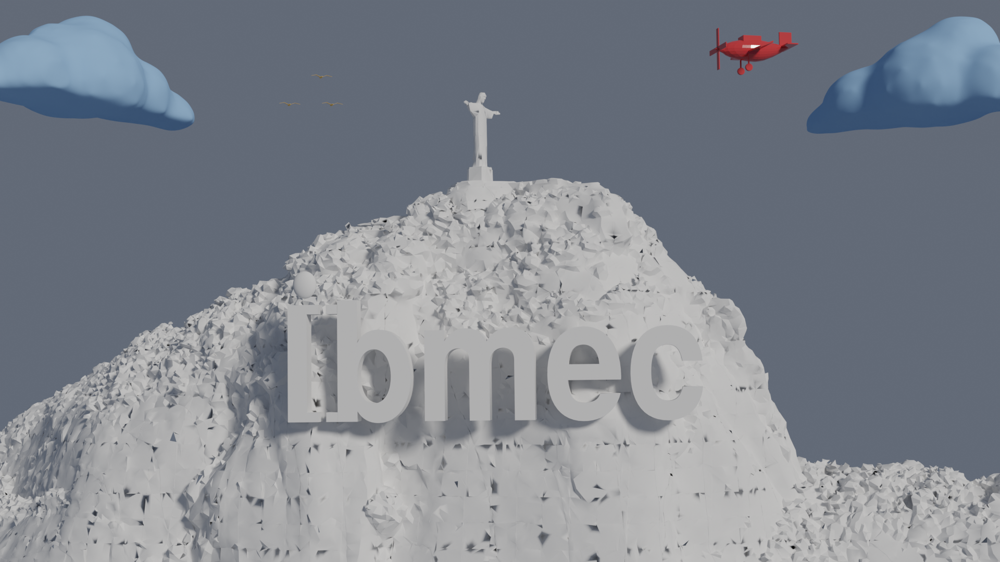
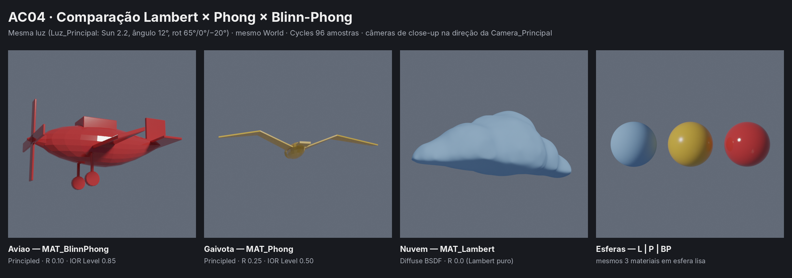
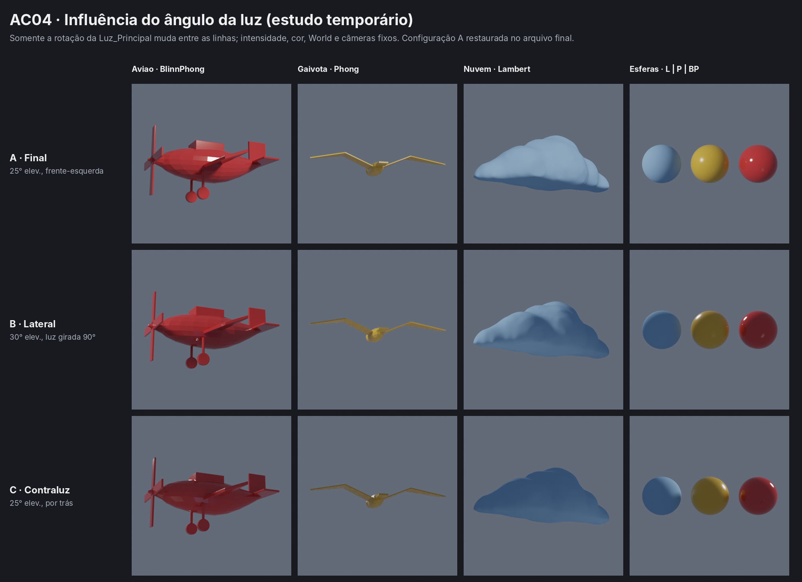

# AC04 – Lambert, Phong e Blinn-Phong

**André Costa** | Computação Gráfica | Blender 4.5 LTS (Cycles)
Cena da AP1 ("Origens") preservada: câmera, composição e logo Ibmec inalterados. Materiais testados só nos objetos autorais.

## 1. Objetos e materiais

| Objeto | Material | Shader | Cor-base | Rugosidade | IOR Level |
|---|---|---|---|---|---|
| `Nuvem` | `MAT_Lambert` | Diffuse BSDF | azul (0.30, 0.52, 0.85) | 0.0 | — |
| `Gaivota` | `MAT_Phong` | Principled BSDF | âmbar (0.85, 0.50, 0.06) | 0.25 | 0.50 |
| `Aviao` | `MAT_BlinnPhong` | Principled BSDF | vermelho (0.70, 0.04, 0.04) | 0.10 | 0.85 |

As cópias da gaivota e da nuvem receberam o mesmo material. No Blender 4.5, o controle Specular foi substituído pelo **IOR Level**.

## 2. Iluminação

- **Luz principal (`Luz_Principal`, Sun):** strength 2.2, cor (1.00, 0.96, 0.90), ângulo 12°, rotação 65° / 0° / −20°. Vem da frente-esquerda, a 25° de elevação.
- **Preenchimento:** World uniforme (0.55, 0.65, 0.85), strength 0.18. O HDRI da AP1 foi desconectado porque achatava as sombras.

Luz e câmeras ficaram iguais em todas as comparações. Como a luz Sun é direcional, os close-ups recebem a mesma iluminação do plano final.

## 3. Comparação

- **Lambert:** totalmente fosco. O sombreamento depende só de N·L e não muda com a posição da câmera.
- **Phong:** highlight largo e suave. Na gaivota ele é discreto, porque as asas são finas e de faces planas; a esfera de referência mostra o efeito com mais clareza.
- **Blinn-Phong:** highlight pequeno, intenso e concentrado. A fuselagem tem aparência polida.
- **Rugosidade e IOR Level:** a rugosidade define a área do brilho (0.25 espalha, 0.10 concentra) e o IOR Level, a intensidade.

**Ângulo da luz** (luz girada temporariamente e depois restaurada): no Lambert, só o terminador se desloca. Os highlights mudam de posição e, em contraluz, somem quase por completo, porque o especular depende da luz e também do observador. Quanto menor a rugosidade, menor a faixa de ângulos em que o brilho aparece. Com a luz a 45° de elevação e ângulo de 4°, o avião e a gaivota quase não mostravam brilho. Por isso a luz foi baixada para 25° e o ângulo aumentado para 12°.

## 4. Limitação

O Principled BSDF é um shader físico (microfacetas GGX, Fresnel, conservação de energia). Ele não implementa as equações clássicas de Phong, I_s = k_s(R·V)^n, nem de Blinn-Phong, I_s = k_s(N·H)^n. Os materiais `MAT_Phong` e `MAT_BlinnPhong` são **aproximações visuais**: a rugosidade baixa faz o papel do expoente n alto, e o IOR Level, o papel de k_s. Só o Lambert é representado de forma direta, pelo Diffuse BSDF.
