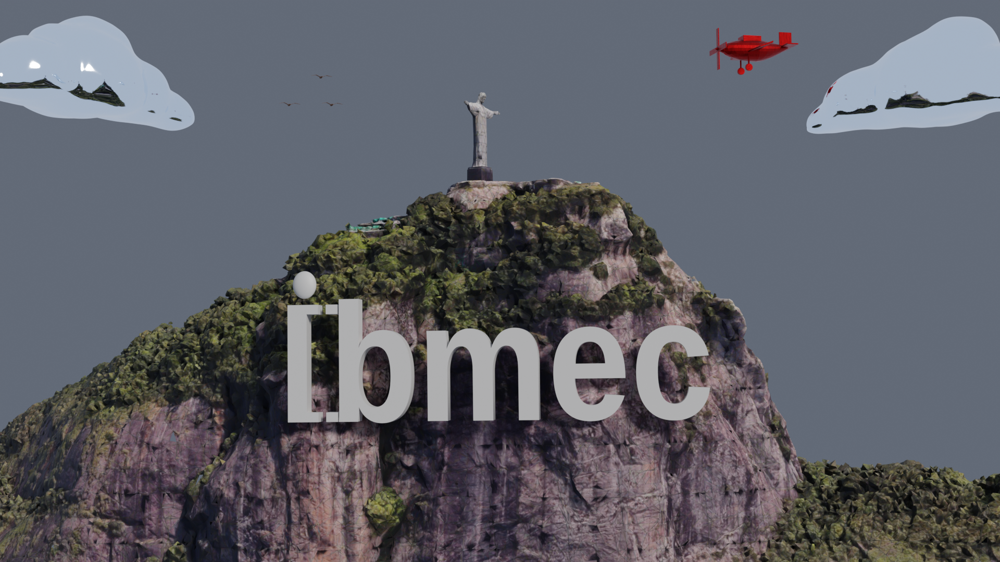
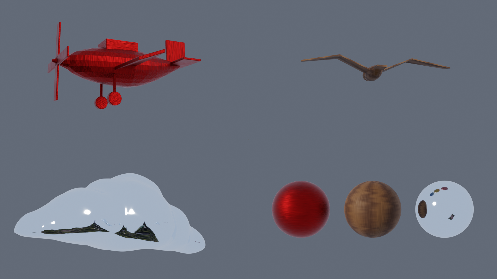
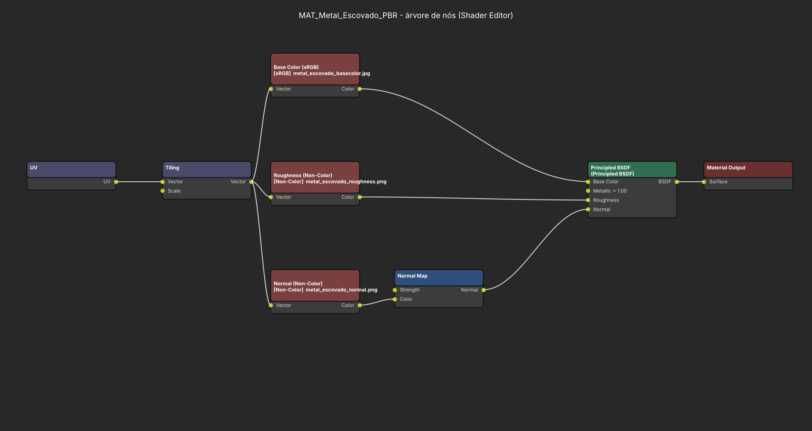
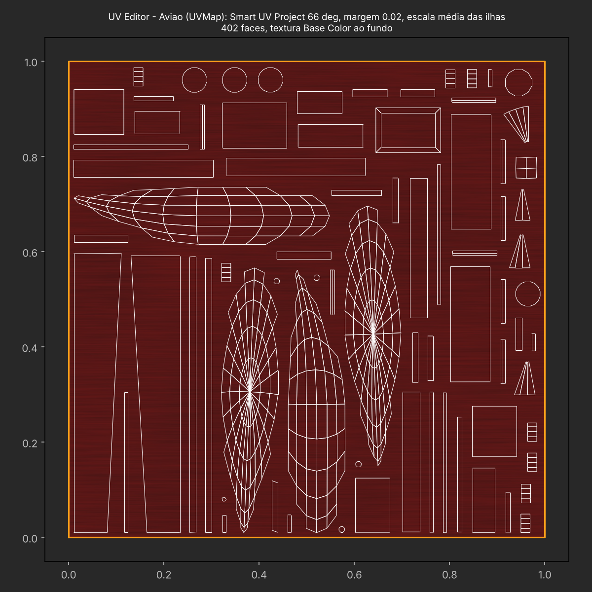

# AC05 – Materiais PBR e Texturas

**André Costa** | Computação Gráfica | Blender 4.5 LTS (Cycles)
Cópia da AC04 salva como `AC05_AndreCosta.blend`. Câmera, composição, luz Sun e objetos da AP1/AC04 foram mantidos. Os arquivos anteriores não foram alterados.



> **Nota sobre a fonte:** o render acima foi gerado em um ambiente sem a fonte *Lagu Sans* (ela fica em `C:/Users/André Costa/Downloads/...` e não está no `.blend`). Por isso o "bmec" saiu com uma fonte substituta (Liberation Sans). Ao abrir o `.blend` com a fonte instalada, a palavra volta ao desenho original da AP1. Recomendo refazer o render final (F12) na minha máquina antes da entrega.

## 1. Objetos e materiais

| Objeto | Material | Aparência | Texturas de imagem | UV |
|---|---|---|---|---|
| `Aviao` | `MAT_Metal_Escovado_PBR` | metal escovado vermelho | Base Color + Roughness + Normal | Smart UV Project |
| `Gaivota` (×3) | `MAT_Madeira_PBR` | madeira entalhada | Base Color + Roughness + Normal | Smart UV Project |
| `Nuvem` (×2) | `MAT_Espelho_PBR` | espelho (cor sólida, sem textura) | — | não necessária |
| `ChristTheRedeemer.002` (Cristo + morro) | `MAT_Cristo_Pedra_PBR` | pedra e vegetação | Base Color (foto do modelo) | UV original do modelo |
| `IBMEC_*` e `Text` (palavra Ibmec) | `MAT_Ibmec_PBR` | cinza-claro liso | nenhuma | — |

As esferas de referência da AC04 (`Ref_Lambert`, `Ref_Phong`, `Ref_BlinnPhong`) mantêm os materiais antigos. Três esferas novas (`Ref_PBR_Metal`, `Ref_PBR_Madeira`, `Ref_PBR_Espelho`) e a câmera `Cam_AC05_Esferas` estão na coleção `AC05_Materiais_Texturas`.



## 2. Propriedades principais

| Material | Base Color | Metallic | Roughness | Outros |
|---|---|---|---|---|
| `MAT_Metal_Escovado_PBR` | mapa (vermelho do avião original) | 1.0 | mapa (≈ 0.22–0.60) | Normal Map, força 0.6 |
| `MAT_Madeira_PBR` | mapa (marrom claro/escuro) | 0.0 | mapa (≈ 0.52–0.96) | Normal Map, força 0.8 |
| `MAT_Espelho_PBR` | (0.78, 0.88, 1.00) | 1.0 | 0.06 | leve azul para manter a identidade da nuvem |
| `MAT_Cristo_Pedra_PBR` | mapa (foto) | 0.0 | 0.85 (constante) | Specular IOR Level 0.3 |
| `MAT_Ibmec_PBR` | (0.80, 0.80, 0.80), a mesma cor da AC04 | 0.0 | 0.5 | sem textura nem relevo |

Metallic = 1 só nos materiais metálicos (metal e espelho). Madeira, pedra e a palavra Ibmec são dielétricos, com Metallic = 0.

## 3. Mapas e ligações

Cadeia usada no metal e na madeira (captura abaixo):

```
Texture Coordinate (UV) → Mapping (Scale) → Image Texture ×3
 ├─ Base Color  (sRGB)      → Principled BSDF · Base Color
 ├─ Roughness   (Non-Color) → Principled BSDF · Roughness
 └─ Normal      (Non-Color) → Normal Map (Tangent, UVMap) → Principled BSDF · Normal
```

- Os mapas de dados (Roughness e Normal) estão como **Non-Color**. O Base Color está como **sRGB**.
- O mapa normal passa pelo nó **Normal Map** (espaço Tangent, convenção OpenGL) antes de chegar ao BSDF.
- No Cristo só há Base Color: o modelo original do Sketchfab não trouxe mapas de rugosidade nem de normal. Por isso a rugosidade é um valor constante.
- Todas as imagens estão **empacotadas** no `.blend`. Eu removi o HDRI `D:/hdri/autumn_road_1k.hdr`, que estava desconectado desde a AC04 e deixava um caminho local quebrado.



> A imagem acima é um diagrama desenhado a partir da árvore de nós real do material. Para a entrega, trocar por um print do Shader Editor no Blender (workspace *Shading*, objeto `Aviao`).

## 4. UV

- **Aviao e Gaivota:** não tinham UV. Usei **Smart UV Project** (limite de ângulo 66°, margem de ilha 0.02). Esse método se adapta bem a malhas de faces planas, com hélice, asas e deriva, e à fuselagem curva.
- Em seguida apliquei **Average Islands Scale** e **Pack Islands**. As ilhas ficam com a mesma densidade de texel, e o grão da madeira e as estrias do metal têm a mesma escala em todas as peças. Todas as ilhas ficam dentro de 0–1 (mín. 0,010 e máx. 0,990), sem sobreposição.
- Os mapas procedurais são **tileáveis** (ruído periódico). O nó Mapping repete o metal 2×, e a repetição não mostra emendas.
- **Cristo:** usei o `UVMap` que já vinha no modelo, sem alterações.



## 5. Origem e licença das texturas

| Textura | Origem | Licença |
|---|---|---|
| `cristo_basecolor_4k.jpg` | `a-ChristTheRedeemer.jpeg`, do modelo *Christ the Redeemer, Rio de Janeiro, Brazil* (Sketchfab), entregue em `christ-the-redeemer-rio-de-janeiro-brazil.7z` | **conferir a licença na página do modelo no Sketchfab** (não consta no pacote) |
| `metal_escovado_*` | procedural, gerada por `AC05_gerar_texturas.py` (ruído filtrado por FFT, estrias na horizontal, normal calculado a partir do relevo) | autoral |
| `madeira_*` | procedural, gerada pelo mesmo script (anéis senoidais deformados por ruído + fibras na vertical) | autoral |

A textura original do Cristo tem 8192×8192 (36 MB). Reduzi para 4096×4096 (JPEG q90) para o `.blend` caber no limite de 100 MB por arquivo do GitHub. O original continua no `.7z`.

## 6. Iluminação e ajustes

- A luz e a câmera são as da AC04: Sun com strength 2.2 e ângulo de 12°, e World com cor (0.55, 0.65, 0.85) e strength 0.18.
- **Único ajuste:** o espelho só mostra o que reflete, e o World da AC04 é escuro, então as nuvens ficavam cinza-escuras. O strength do World agora vale **0.90 apenas para raios glossy** (nó *Light Path › Is Glossy Ray*), e continua 0.18 para câmera e luz difusa. Os outros materiais recebem a mesma iluminação da AC04.
- **Metal:** o highlight alongado segue a direção das estrias, e o relevo do mapa normal aparece onde a luz Sun incide em ângulo rasante.
- **Madeira:** a rugosidade alta (≈ 0.5–0.9) deixa o brilho largo e fraco. As gaivotas são pequenas no plano principal, então o grão aparece melhor no close-up e na esfera de referência.
- **Espelho:** não tem cor própria. A nuvem mostra o céu, o morro e a luz Sun como pontos brilhantes, e por isso a aparência muda com o ponto de vista.
- **Cristo:** com Roughness 0.85, o relevo e o contraste vêm quase todos da textura e da sombra da luz Sun.

## 7. Como reproduzir

```bash
python AC5/AC05_gerar_texturas.py <pasta do .7z extraído> AC5/texturas
blender -b AC4/AC04_AndreCosta.blend --python AC5/AC05_AndreCosta.py
```

`AC05_renderizar.py` gera os renders e os diagramas (usa o módulo `bpy` 4.5).
