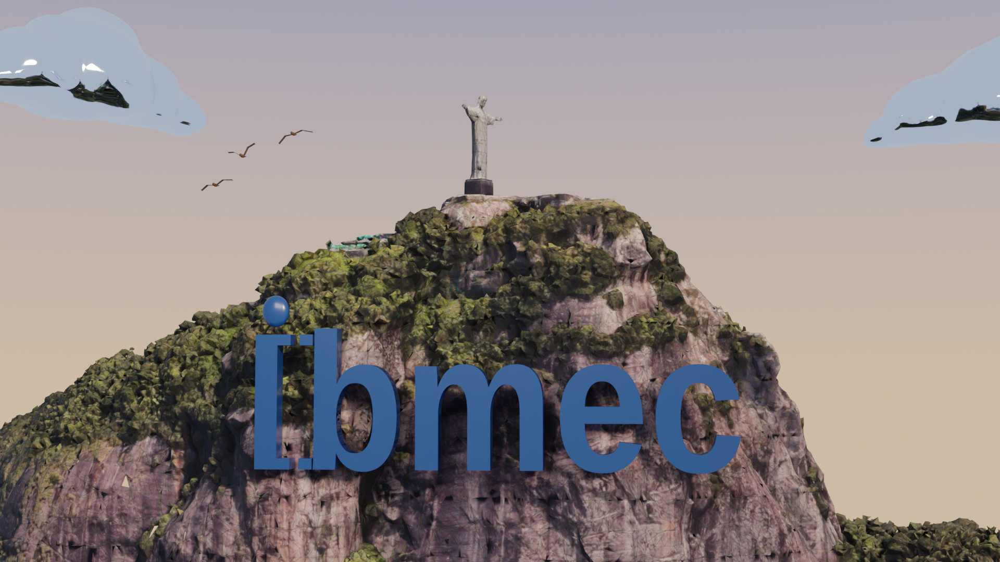

# AP2 – "Origens": Ibmec em 15 segundos

**André Costa** | Computação Gráfica | Blender 4.5 LTS (Cycles)

| Entregável | Arquivo |
|---|---|
| Cena final | `AP2_AndreCosta.blend` (cópia da AC05; os arquivos da AP1, AC04 e AC05 não foram alterados) |
| Vídeo | `AP2_AndreCosta.mp4`: 1920×1080, 24 fps, 360 quadros (15 s), H.264 |
| Imagem renderizada | `AP2_AndreCosta_render_final.png` (quadro 330) |
| Storyboard atualizado | `AP2_AndreCosta_storyboard.png` |
| Scripts | `AP2_AndreCosta.py` (gera o `.blend` a partir da AC05) e `AP2_renderizar.py` (render + MP4) |



## 1. Conceito e resumo

**Título:** "Origens" (o mesmo da AP1).

A palavra **Ibmec** surge da rocha do Corcovado, aos pés do Cristo Redentor. A ideia é mostrar uma instituição nascida no Rio de Janeiro e construída sobre uma base sólida. A peça começa num plano aberto do morro. A câmera se aproxima, as letras saem da pedra uma a uma e o pingo do "i" cai do alto e quica no lugar, fechando a palavra. No fim, o logo fica legível num quadro frontal, com o Cristo acima. O avião vermelho (inovação, futuro) cruza o céu da esquerda para a direita. As gaivotas (vida carioca) passam em primeiro plano e depois circulam o Cristo. As nuvens derivam devagar e a luz esquenta como num fim de tarde.

## 2. Momentos e planos

Os momentos são os mesmos do storyboard da AP1. Os marcadores na timeline têm os nomes de cada momento.

| Momento | Quadros (tempo) | Ação | Câmera |
|---|---|---|---|
| **1. Início** | 1–90 (0–3,75 s) | Plano aberto do morro e do Cristo. O logo está escondido dentro da rocha. As gaivotas entram em primeiro plano pela esquerda. O avião entra pela esquerda por volta do quadro 30. | Aberta e alta, começa a andar devagar (ease-in). |
| **2. Destaque** | 90–270 (3,75–11,25 s) | O "I" com serifas emerge (92), depois "b" (106), "m" (120), "e" (134) e "c" (148). O pingo do "i" cai e quica (188–216). As gaivotas chegam ao Cristo e passam a circulá-lo. O avião cruza o céu. O céu e o sol esquentam e a luz de destaque do logo acende. | Dolly-in contínuo. No quadro 180 a câmera passa exatamente pela posição e enquadramento da AP1 (marcador `Pico_logo_AP1`). |
| **3. Encerramento** | 270–360 (11,25–15 s) | O avião sai pela direita (≈ quadro 280). O logo completo e legível fica no terço inferior, com o Cristo acima. As gaivotas continuam circulando e a cena respira por cerca de 2 s. | Quadro frontal estável (300), com um drift mínimo até 360 para não ficar congelado. |

**Mudanças em relação ao storyboard da AP1:** só mudei detalhes. As gaivotas, depois de cruzar o primeiro plano, passam a circular o Cristo, o que mantém movimento no plano final. O enquadramento final ficou um pouco mais próximo que o da AP1 (21,2 em vez de 24,6 unidades do logo) para dar mais destaque à palavra sem cortar o Cristo. O storyboard atualizado, com quadros reais do render, está em `AP2_AndreCosta_storyboard.png`.

## 3. Animação: propriedades, timing e interpolação

| Elemento | Propriedade animada | Keyframes / técnica | Interpolação e motivo |
|---|---|---|---|
| `Camera_Principal` | location (com constraint **Track To** apontando para `Camera_Alvo`) | 1, 180, 300 e 360 | Bézier com alças *Auto Clamped*. A velocidade sobe devagar, tem o pico por volta do quadro 100 e cai até quase parar em 300. A curva foi conferida medindo o deslocamento por quadro, sem trancos nos keyframes do meio. |
| `Camera_Alvo` (empty) | location | 1, 180, 300 e 360 | Bézier. O ponto de interesse desce do meio do morro (plano aberto) para o logo, e a câmera nunca gira de forma brusca. |
| `Ibmec_Letra_b/m/e/c`, `IBMEC_I`, `IBMEC_Serifas_b` | location Z local (normal da rocha) | Duas chaves por letra, 34 quadros cada, com defasagem de 14 quadros | **Back / Ease Out** (overshoot 1,1). A letra sai da pedra, passa um pouco do ponto e assenta, como algo sendo "construído". |
| `IBMEC_Esfera` (pingo do i) | scale (188→194) e location Y local (188→216) | 4 chaves | Escala em Bézier (aparece). Queda em **Bounce / Ease Out** (quica no lugar). |
| `Aviao` | constraint **Follow Path** em `Trajeto_Aviao` (`eval_time` da curva) | 1 → 360 | **Linear**: velocidade de cruzeiro constante. O *Follow Curve* alinha o nariz (eixo X) com a tangente e o *tilt* dos pontos da curva inclina as asas nas curvas. |
| `Gaivotas_Bando` (empty, pai das 3 gaivotas) | constraint **Follow Path** em `Trajeto_Gaivotas` | 1 → 360 | **Linear**. As gaivotas ficam em formação (offsets locais) e seguem a tangente. |
| `Gaivota`, `.001`, `.002` | shape key `Asas_Cima` (valor −0,7 ↔ 1) | Ciclo de 10 quadros com modificador **Cycles** | Bézier, 2,4 batidas por segundo, com fase diferente em cada ave para não baterem em sincronia. |
| `Nuvem`, `Nuvem.001` | location | 1 → 360 | **Linear**: deriva constante, com velocidades diferentes (2,2 e 1,3) para dar paralaxe. |
| `Luz_Principal` (Sun) | color, energy, rotation | 1 → 300/360 | Bézier. A cor vai de (1,00; 0,95; 0,88) para (1,00; 0,80; 0,60), a força de 2,2 para 2,6 e o sol desce 6°. |
| `Luz_Destaque_Ibmec` (Area) | energy | 80 → 170 → 360 | Bézier, 0 → 900 W → 750 W. Acende junto com as letras. |
| World (`Ceu_Mix`) | fator da mistura céu frio/quente | 40 → 300 | Bézier. |

**Como as letras foram separadas sem trocar a fonte:** a palavra "bmec" é um objeto de texto. Para animar cada letra sem converter o texto em malha (o que perderia a fonte original), criei quatro objetos de texto (`Ibmec_Letra_*`), filhos do texto original. Cada um tem a palavra inteira, com o material da marca só na sua letra e `MAT_Invisivel` (Transparent BSDF) nas outras, usando o material por caractere. O texto original virou o pivô `Ibmec_Palavra_Pivo` e não renderiza. Assim as letras mantêm exatamente o espaçamento e a fonte da AP1.

## 4. Iluminação e renderização

- **Luz principal:** a Sun da AC04/AC05 (`Luz_Principal`) foi mantida e agora "esquenta" ao longo da peça.
- **Luz de destaque:** `Luz_Destaque_Ibmec`, uma Area retangular de 7×3 à frente e acima do logo, mirando o centro da palavra. Ela orienta a atenção para as letras no momento em que elas surgem.
- **World:** a iluminação ambiente da AC05 continua igual (força 0,18 para raios difusos e 0,90 para reflexos). Só os **raios de câmera** veem um céu em gradiente (*Light Path › Is Camera Ray*), que muda de azul-claro para laranja no horizonte. Assim o fundo deixa de ser chapado e os materiais recebem a mesma luz da AC05.
- **Coleções de estudo:** as esferas e câmeras de comparação da AC04/AC05 continuam no arquivo, mas com render desligado.

### 4.1 Como o render foi feito

O render passou por quatro etapas: montar a cena, testar em baixa resolução, renderizar os quadros finais em PNG e juntar os quadros num MP4.

**1. Montagem da cena por script.** O `AP2_AndreCosta.py` abre o `.blend` da AC05 (com a cena da AP1, as luzes da AC04 e os materiais da AC05), cria a animação e grava `AP2_AndreCosta.blend`. Os arquivos das atividades anteriores não são alterados. No fim, o script empacota a fonte Lagu Sans dentro do `.blend`.

**2. Por que Cycles e não Eevee.** Cycles é um *path tracer*: para cada pixel ele traça raios a partir da câmera, que batem nos objetos, ricocheteiam e chegam às luzes. Isso calcula de forma física as sombras, os reflexos das nuvens espelhadas, o verniz (*coat*) das letras e a luz indireta da rocha. A máquina onde renderizei não tem placa de vídeo, e o Eevee (que é rasterização em tempo real) precisa de GPU para funcionar. O Cycles roda só na CPU.

**3. Configurações de amostragem e ruído.**

| Ajuste | Valor | Para que serve |
|---|---|---|
| Amostras (*samples*) | 64 no `.blend`, 32 no render final | Cada amostra é um caminho de luz por pixel. Poucas amostras deixam a imagem granulada; muitas deixam o render lento. |
| Amostragem adaptativa | limiar 0,01 | O Cycles para de amostrar os pixels que já estão limpos (céu liso) e gasta o tempo nos difíceis (vegetação, bordas das letras). |
| *Denoise* | OpenImageDenoise, com passes de *albedo* e *normal* | Uma rede neural remove o ruído que sobra. Os passes de cor e normal ajudam a preservar as bordas das letras e as texturas. Foi o que permitiu usar só 32 amostras. |
| *Light paths* | total 12, difuso 4, brilho 4, transparência 16 | Limita quantas vezes um raio pode ricochetear. O valor de 16 para transparência é necessário porque cada letra tem cópias invisíveis (ver seção 3). Com poucos *bounces* transparentes, as letras de trás apareciam pretas. |
| *Clamp* indireto | 10 | Corta pontos isolados muito brilhantes (*fireflies*) nos reflexos. |
| *Persistent Data* | ligado | Mantém a geometria e as texturas na memória entre um quadro e o próximo, sem recarregar o morro a cada quadro. |
| Gestão de cor | Filmic, sRGB | Comprime as altas luzes de forma suave, para o céu do fim de tarde não estourar em branco. |
| Resolução | 1920×1080 a 100 %, 24 fps, quadros 1–360 | Full HD, 15 s de vídeo. |

**4. Testes antes do render final.** Para conferir enquadramento, timing e trajetórias, renderizei quadros soltos em 25 % a 50 % da resolução e com 12 amostras (alguns segundos cada). Também calculei a posição de cada objeto na tela com `world_to_camera_view`, quadro a quadro, para ter certeza de que o avião e as gaivotas não saíam do quadro. Isso evitou renderizar de novo as 2 a 3 horas do vídeo completo por causa de um erro de enquadramento.

**5. Render final em PNG e depois MP4.** O `AP2_renderizar.py` abre o `.blend` e renderiza os 360 quadros como **PNG** (`f_0001.png` … `f_0360.png`), em vez de gerar o vídeo direto. Assim, se o render parar no meio, nada se perde: com `use_overwrite = False` o Blender pula os quadros já prontos e continua de onde parou. Isso aconteceu de verdade: o computador reiniciou no quadro 235, apaguei o único quadro que tinha ficado incompleto e o render seguiu do 235 ao 360. Cada quadro levou de 20 a 31 s na CPU, ou seja, cerca de 2 a 3 horas no total.

Com os 360 PNGs prontos, o **ffmpeg** monta o vídeo:

```bash
ffmpeg -framerate 24 -i f_%04d.png -c:v libx264 -preset slow -crf 18 -pix_fmt yuv420p -movflags +faststart AP2_AndreCosta.mp4
```

- `libx264`: codec **H.264**, como o enunciado pede.
- `-crf 18`: qualidade quase sem perda visível (quanto menor, melhor; 18 é considerado "visualmente sem perdas").
- `-pix_fmt yuv420p`: formato de cor que todo player (Windows, celular, navegador) aceita.
- `+faststart`: o vídeo começa a tocar antes de terminar de baixar.

O resultado tem 1920×1080, 24 fps, 360 quadros, 15,0 s e cerca de 8,8 MB.

**6. Imagem e storyboard.** O render final (`AP2_AndreCosta_render_final.png`) é o quadro 330, tirado da mesma sequência. O storyboard junta 8 quadros do render final (1, 60, 130, 180, 205, 270, 330 e 360).

**No Blender com interface**, o mesmo resultado sai direto: o `.blend` já está configurado com saída FFMPEG / MPEG-4 / H.264, qualidade *High*, em `//AP2_AndreCosta.mp4`. Basta usar **Render › Render Animation** (Ctrl+F12). Com GPU, dá para trocar *Device* para GPU Compute e o render fica bem mais rápido.

## 5. Materiais e texturas da AC05

| Objeto | Material | Ajuste na AP2 |
|---|---|---|
| `Aviao` | `MAT_Metal_Escovado_PBR` (Base Color sRGB + Roughness e Normal Non-Color → Normal Map) | Nenhum. O UV (Smart UV Project) e o tiling 2× ficaram estáveis com o avião em movimento. |
| `Gaivota` ×3 | `MAT_Madeira_PBR` (3 mapas, mesma cadeia) | A escala das aves subiu de 0,4 para 0,6 para elas ficarem legíveis. O UV não muda com isso, porque a textura está em coordenadas UV. |
| `Nuvem` ×2 | `MAT_Espelho_PBR` | Nenhum. O reflexo muda com a câmera e com a deriva, o que reforça o movimento. |
| `ChristTheRedeemer.002` | `MAT_Cristo_Pedra_PBR` (Base Color 4K) | Nenhum. |
| Palavra Ibmec | `MAT_Ibmec_PBR` | O cinza da AC05 virou **azul Ibmec** (≈ #0B4489), com Roughness 0,32 e Coat 0,35 (verniz leve). Continua sem textura nem relevo, para não prejudicar a leitura. O brilho do coat aparece nas bordas das letras quando a câmera se move. |
| Pingo do i (`IBMEC_Esfera`) | `MAT_Ibmec_Ponto_Amarelo` (cópia do `MAT_Ibmec_PBR`) | Mesma receita (Roughness 0,32, Coat 0,35), só a cor base muda para **amarelo** (≈ #F7B800), a cor de destaque da marca. Assim o pingo que cai e quica chama a atenção no quadro. |

- Os mapas de dados continuam como **Non-Color** e os normais passam pelo nó **Normal Map** (Tangent).
- Todas as imagens continuam **empacotadas** no `.blend`.
- Conferi as texturas em close-up das gaivotas batendo asa e do avião durante o voo. Não apareceram emendas nem estiramento.

## 6. Desafios e soluções

1. **Letras sumindo no render:** as cópias invisíveis de cada letra ocupavam exatamente o mesmo lugar da letra visível. Com faces coplanares, o Cycles descartava a face visível. Resolvi com um recuo de 0,004 no eixo Z local entre os objetos-letra (imperceptível) e subi os *transparent bounces* para 16.
2. **Letras aparecendo antes da hora:** a face do morro é irregular, e com um recuo de 1,6 o "c" ainda aparecia no plano aberto. Aumentei o recuo para 3,0.
3. **Gaivotas e avião saindo pelo topo do quadro:** como a câmera se aproxima, o céu visível diminui. Calculei a posição de tela (`world_to_camera_view`) quadro a quadro e baixei as trajetórias até que o avião entrasse pela esquerda e saísse pela direita dentro do quadro, e as gaivotas ficassem sempre visíveis.
4. **Batida de asas numa malha única:** a gaivota da AP1 é uma malha só. Em vez de separar as asas, criei uma shape key que gira os vértices das asas em torno do eixo do corpo e a animei em ciclo.
5. **Fonte Lagu Sans e o "I" com serifas:** a fonte não estava empacotada (ficava só em `C:/Users/André Costa/Downloads/lagu-sans/`). Num primeiro render, feito num computador sem ela, o "bmec" saiu numa fonte substituta e o "b" deslocou, sobrepondo as serifas modeladas do "I" (que viraram um "[." estranho). Isso mostrou que o "I" e as serifas dependem das medidas exatas da Lagu Sans. Solução: a fonte agora está **empacotada no `.blend`** (o script faz `font.pack()` antes de salvar) e o vídeo foi renderizado de novo com ela.

## 7. Fontes e licenças

| Recurso | Origem | Licença |
|---|---|---|
| Modelo e textura do Cristo/Corcovado | *Christ the Redeemer, Rio de Janeiro, Brazil* (Sketchfab) | conferir na página do modelo (já indicado na AC05) |
| Fonte Lagu Sans (Alessio Laiso) | arquivo da fonte usado desde a AP1, empacotado no `.blend` | gratuita para uso pessoal; uso aqui é acadêmico, sem fins comerciais |
| Texturas de metal e madeira | procedurais, `AC5/AC05_gerar_texturas.py` | autoral |
| Logo, avião, gaivotas, nuvens, animação, luzes e céu | modelados e animados pelo aluno | autoral |
| Áudio | não utilizado | — |

## 8. Como reproduzir

```bash
blender -b AC5/AC05_AndreCosta.blend --python AP2/AP2_AndreCosta.py   # gera AP2/AP2_AndreCosta.blend
python AP2/AP2_renderizar.py <pasta_quadros> 32                       # módulo bpy 4.5: render + MP4
```

No Blender com interface: abrir `AP2_AndreCosta.blend` e usar **Render › Render Animation**.
